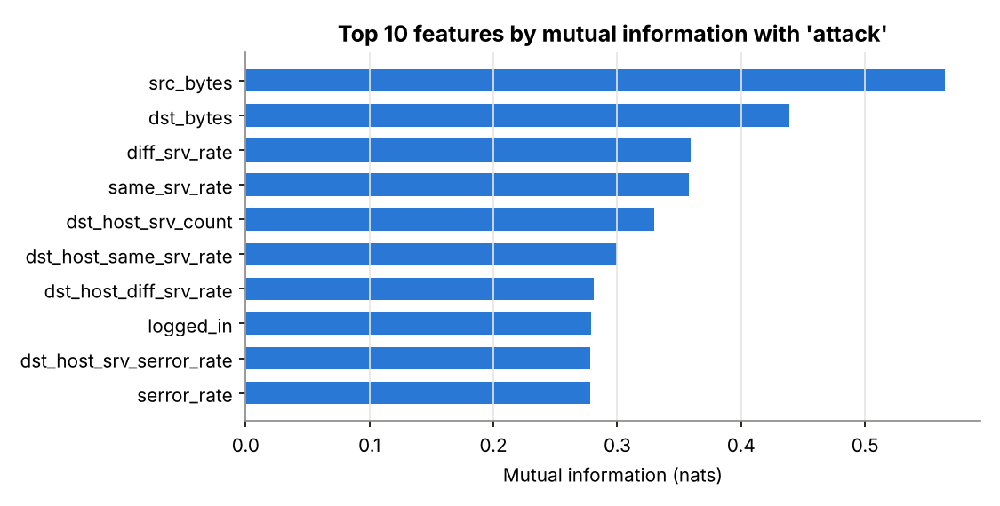

# Network Intrusion Data: Exploratory Analysis and a Baseline Detector

What does attack traffic look like, which features separate it from normal traffic, and how well does a simple model detect attacks it has never seen?

**Data:** [NSL-KDD](https://www.unb.ca/cic/datasets/nsl.html) (Tavallaee et al., 2009; Canadian Institute for Cybersecurity). 125,973 training and 22,544 test connections, 41 features each.
**Tools:** Python (pandas, matplotlib, scikit-learn)
**Files:** [`analysis.ipynb`](analysis.ipynb) · [`results/summary.json`](results/summary.json)

This sits next to my MSc dissertation topic (hybrid intrusion detection). It is a standalone exploratory analysis, not the dissertation.

## What I did

- Mapped 39 attack types to four categories (DoS, Probe, R2L, U2R) and compared the training and test mix.
- Checked data quality (no missing values; one constant column; no unseen services).
- Profiled attack rates by protocol, service and connection flag.
- Ranked features by mutual information with the attack label.
- Trained a baseline random forest and compared cross-validation with the official test set.

## Key findings

- 16.6% of test connections are **attack types never seen in training**; R2L attacks rise from 0.8% to 12.8% of traffic.
- **99.0%** of `S0` connections (attempts with no reply) are attacks; **84%** of ICMP traffic is attack traffic.
- Cross-validation accuracy is **99.88%**, but test accuracy is **76.5%**: random splits hide the real difficulty.
- The model detects **76.8%** of known attack types but only **22.0%** of new ones, and **5.2%** of R2L attacks.
- False alarm rate on normal traffic: **2.7%**.

## Limitations

NSL-KDD comes from 1998 simulated traffic, so it is a research benchmark, not today's network. The model is an untuned baseline.
