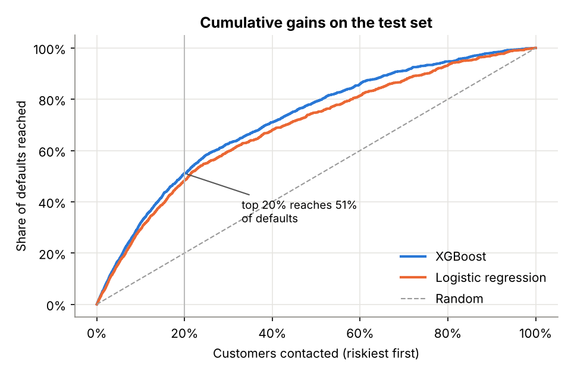
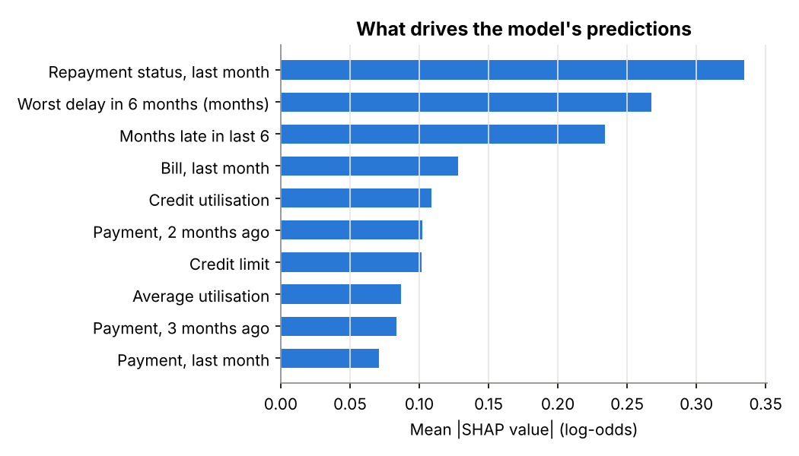
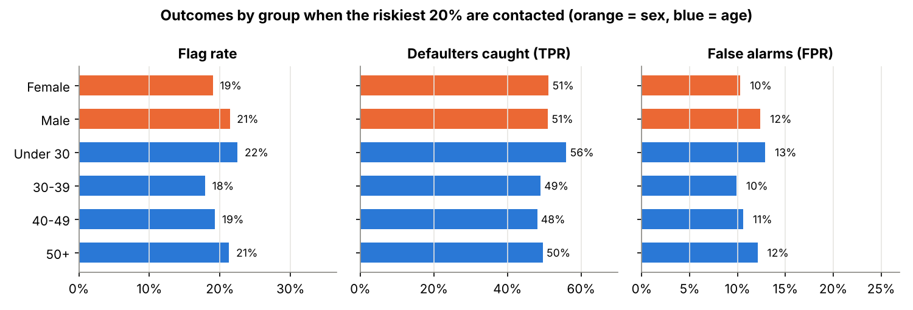
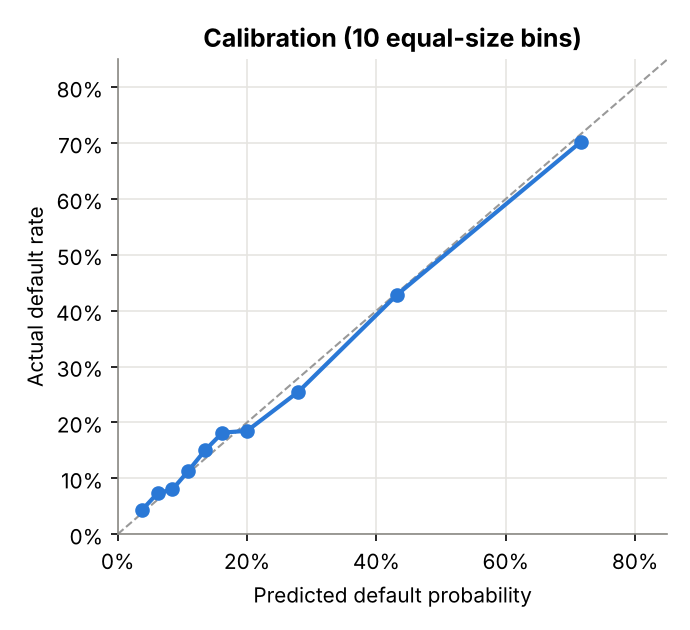
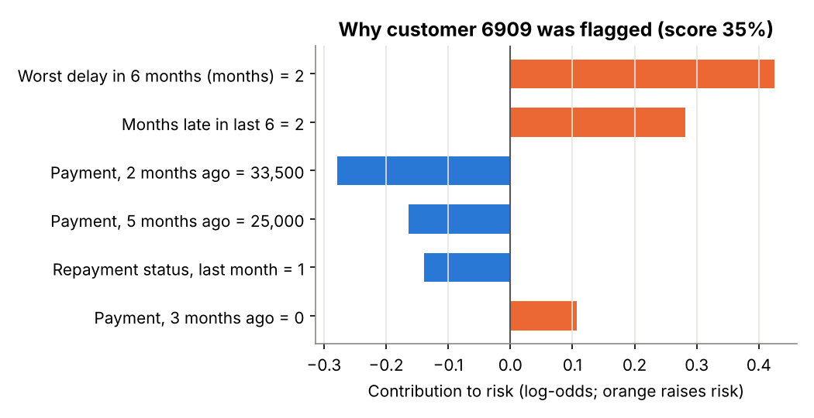

# Credit Card Default Risk: An Explainable, Fairness-Checked Model

A card issuer wants to contact customers *before* they miss a payment. Which customers are most likely to default next month, why, and does the model treat men and women, and younger and older customers, fairly?

**Data:** *Default of Credit Card Clients* (Yeh & Lien, 2009; UCI ML Repository, CC BY 4.0): 30,000 customers, six months of repayment history, bills and payments.
**Tools:** Python (pandas, scikit-learn, XGBoost, SHAP, matplotlib)
**Files:** [`analysis.ipynb`](analysis.ipynb) · [`results/summary.json`](results/summary.json)

## What I did

- Checked data quality, including undocumented category codes and duplicate-looking rows.
- Engineered behavioural features: utilisation, months late, worst delay, payment ratio.
- Kept sex, age and marital status **out** of the model, then tested whether outcomes were still fair.
- Compared logistic regression with XGBoost using 5-fold cross-validation and a held-out test set (ROC AUC, PR AUC, Brier, KS, top-20% capture).
- Checked calibration, explained the model globally and per customer with SHAP, and measured flag rate, true positive rate and false positive rate by sex and age band.

## Key findings

- XGBoost: test ROC AUC **0.781** (CV 0.785 ± 0.005) vs **0.746** for logistic regression.
- Contacting the riskiest 20% reaches **51%** of next month's defaults; **56.5%** of those contacted default, 2.6× the 22.1% average.
- Calibrated to within 3 points in every score band.
- Repayment history carries 42% of the model's attribution.
- Equal catch rate for men and women (51%), but under-30s are flagged most and 30-39s least: flag-rate ratio **0.80**, right on the four-fifths line.

| SHAP feature importance | Outcomes by group |
|---|---|
|  |  |

| Calibration | Reason codes for one customer |
|---|---|
|  |  |

## Limitations

Taiwan in 2005, not a UK bank today; random rather than out-of-time split (no date column); one-month horizon with no loss amounts; small groups at older ages.
