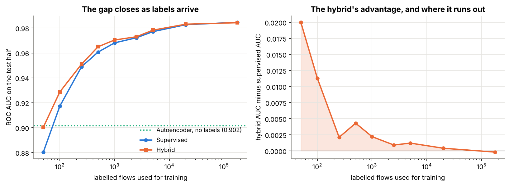
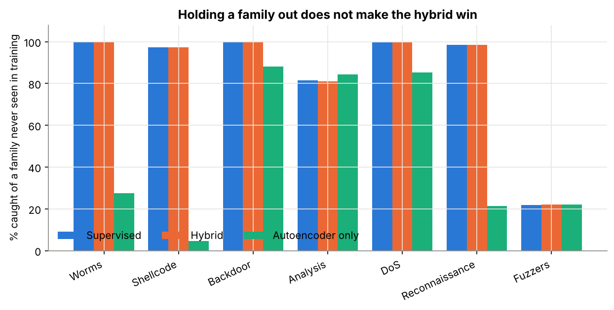

# An AI-Powered Hybrid Intrusion Detection System

**MSc Data and Artificial Intelligence dissertation, University of Wales Trinity Saint David, 2026.**

> Designing and evaluating an AI-powered hybrid intrusion detection system integrating anomaly
> detection and supervised learning, applying statistical analysis, feature engineering, and model
> evaluation techniques to network security datasets.

Does pairing an anomaly detector with a trained classifier actually catch attacks the classifier
has never seen? I built the hybrid and tried to break it. It does not help the way the title
assumes, and the notebook reports that rather than the result I hoped for.

**Data:** [UNSW-NB15](https://research.unsw.edu.au/projects/unsw-nb15-dataset) (Moustafa & Slay,
2015), the partitioned set: 175,341 training and 82,332 test flows,
42 features, nine attack families.
**Tools:** Python (pandas, scikit-learn, XGBoost, SHAP)
**Files:** [`analysis.ipynb`](analysis.ipynb) · [`results/summary.json`](results/summary.json)



## What I did

- Trained an autoencoder (42-64-32-64-42) on **normal traffic only** and scored every flow by its
  reconstruction error, with the threshold set at the 95th percentile of normal training traffic,
  so no attack and no test row touches it.
- Added an Isolation Forest as a second, differently-shaped anomaly signal.
- Trained a supervised gradient-boosted classifier, then a **hybrid**: the same classifier with
  both anomaly scores as extra features.
- Evaluated three ways: the published split, whole attack families deleted from training, and a
  label-scarcity curve from 50 labelled flows to the full 175,341.

## Key findings

- **The hybrid does not beat the supervised model** on the standard split: ROC AUC
  0.9836 against 0.9837. The anomaly score is a function of the same
  features the classifier already reads, so it carries no new information.
- **Deleting a whole attack family from training does not change that.** Across eight holdout runs
  the hybrid stays within 0.002 AUC of the supervised model.
- **The supervised model generalises to unseen families better than expected.** Backdoor and Worms
  are caught at 100% having never been labelled. The exception is **Fuzzers at
  21.9%**, and the anomaly detector is no better there
  (22.1%), so there is nothing for the hybrid to rescue.
- **The hybrid earns its keep only at the cold start.** With 50 labelled flows it gains
  **+0.020** AUC; by 250 the gap is noise, and on the full training set it is
  -0.0002.
- **With no labels at all the autoencoder alone reaches ROC AUC 0.9015**, catching
  76.3% of attacks at a 9.8% false alarm rate.
- `recon_error` ranks **2 of 44** by mean absolute SHAP
  value. The model leans on the anomaly score heavily and still gains nothing from it, which is
  redundancy rather than irrelevance.
- Both tree models flag **26.4%** of normal test traffic. The
  published split has a real distribution shift between its halves, so these numbers are far worse,
  and far more honest, than the cross-validation figures usually quoted for this dataset.



## Detection by attack family

| Family | Flows | Hybrid | Anomaly detector alone |
|---|---:|---:|---:|
| Generic | 18,871 | 100.0% | 98.2% |
| Exploits | 11,132 | 99.4% | 71.8% |
| Fuzzers | 6,062 | 88.8% | 35.9% |
| DoS | 4,089 | 99.9% | 82.7% |
| Reconnaissance | 3,496 | 99.9% | 33.6% |
| Analysis | 677 | 95.7% | 97.9% |
| Backdoor | 583 | 99.8% | 91.8% |
| Shellcode | 378 | 98.7% | 30.2% |
| Worms | 44 | 100.0% | 25.0% |

## Limitations

- UNSW-NB15's attack traffic is **synthesised**, not captured from real attackers, so a model that
  separates it from real background traffic may be learning the generator.
- The autoencoder reads the same features as the classifier. A fairer hybrid would give it
  information the classifier does not have: raw payloads, or time-windowed behaviour per host.
- "Caught" is per flow at a fixed threshold. Operationally a detector is judged per incident and
  per analyst hour, and a 26.4% false alarm rate on millions of daily
  flows is unusable whatever the AUC says.
- The dissertation used a PyTorch autoencoder; this notebook uses scikit-learn's `MLPRegressor`
  fitted to reproduce its own input, which is the same architecture and optimiser and runs anywhere
  without a GPU.
- Only two anomaly methods and one classifier family were tested.

## Conclusion

The architecture in the title does not improve detection when labelled attacks are plentiful, and
holding whole families out of training does not change that. It helps at the cold start, and that
is a narrow but useful answer: the case for pairing anomaly detection with a classifier is about
the weeks before anyone has labelled anything, not about steady-state accuracy.

## Reproducing

```bash
pip install -r ../requirements.txt
jupyter nbconvert --execute --inplace analysis.ipynb
python ../scripts/build_site_data.py
```

The notebook downloads UNSW-NB15 into `data/` on first run (about 48 MB, gitignored).
