# Dev Mistri · Data Analysis Portfolio

Data analyst with an MSc in Data and Artificial Intelligence (UWTSD Birmingham) and two years of backend development spent cleaning, validating and querying production data. Based in Birmingham, UK.

**🌐 Website:** [devmistri.co.uk](https://devmistri.co.uk/) · **📄 Resume:** [online resume](https://devmistri.co.uk/resume.html) · [LinkedIn](https://www.linkedin.com/in/dev-mistri-) · [GitHub](https://github.com/D3vxc)

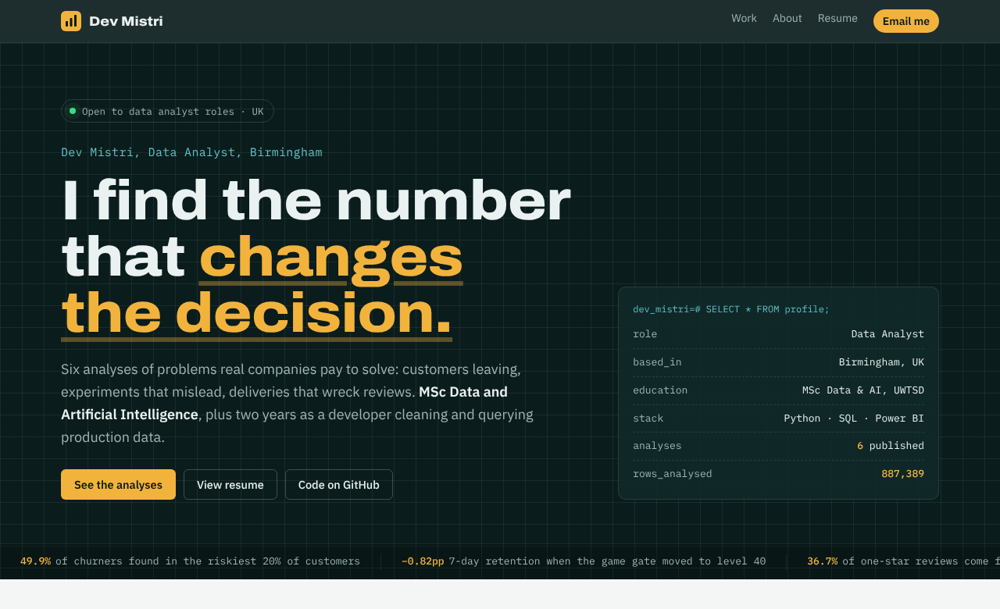

## Contents

- [Six analyses at a glance](#six-analyses-at-a-glance)
- [The analyses, with charts](#the-analyses-with-charts)
- [The website](#the-website)
- [Repository layout](#repository-layout)
- [Run it yourself](#run-it-yourself)

## Six analyses at a glance

| # | Business problem | Data | Skills | Headline result |
|---|---|---|---|---|
| 01 | [Who is about to cancel, and who to call first](04-telecom-customer-churn) | IBM Telco churn · 7,043 customers | Python, logistic regression, segmentation | The riskiest 20% of customers by model score contain **49.9%** of actual churners |
| 02 | [Did moving the paywall gate hurt retention?](05-mobile-game-ab-test) | Cookie Cats A/B test · 90,189 players | A/B testing, z-test, bootstrap, SRM check | 7-day retention fell **0.82 points** (p = 0.002): don't ship |
| 03 | [What late deliveries cost in customer reviews](06-ecommerce-late-deliveries) | Olist marketplace · 99,441 orders | SQL joins, CTEs, window functions | Late orders are 6.8% of deliveries but **36.7%** of one-star reviews |
| 04 | [Where a UK retailer's revenue comes from](01-uk-online-retail) | UCI Online Retail · 541,909 lines | SQL, RFM, cohort retention | **14%** of customers generate **45%** of revenue |
| 05 | [What a 99.9% accurate model is hiding](03-network-traffic-eda) | NSL-KDD · 148,517 connections | EDA, scikit-learn, evaluation design | Accuracy drops from **99.88%** to **76.5%** once attacks are new |
| 06 | [UK house prices since 1953](02-uk-house-prices) | Nationwide HPI · 290 quarters | Time series, data validation | The early-1990s crash took **8.5 years** to recover |

Every analysis starts from a question a manager would ask, uses real public data, checks data quality before drawing conclusions, and ends with a recommendation and its limitations.

## The analyses, with charts

### 01 · Telecom customer churn: who to call first

> Subscription businesses lose customers every month. Which customers are likely to leave, why, and where should a retention team spend its time?

- **26.5%** of customers left, taking **30.5%** of monthly revenue ($1.67m a year).
- Month-to-month customers churn at **42.7%**, against **2.8%** on two-year contracts. In the first six months, churn is **52.9%**.
- A logistic regression (ROC AUC **0.844**) puts **49.9%** of the people who actually left into the riskiest 20% of customers.

| Churn by contract and tenure | Actual churn by predicted risk decile |
|---|---|
| 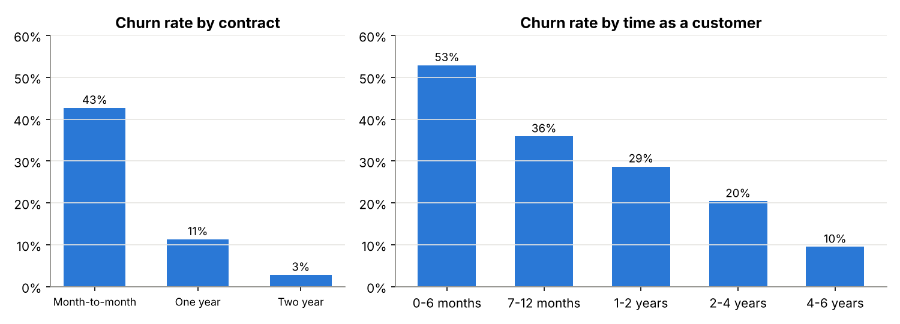 | 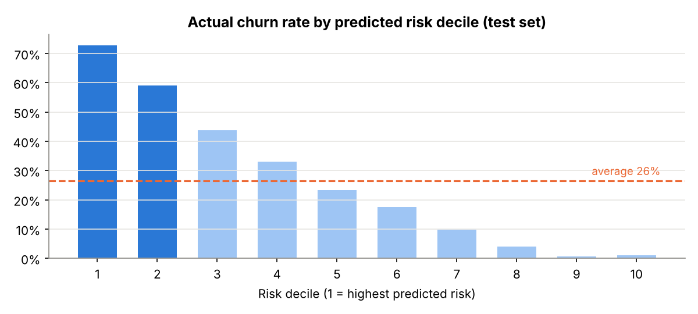 |

**Recommendation:** contract upgrades during the first six months, an incentive to move to automatic payment, and tech support bundled with fibre. → [Notebook](04-telecom-customer-churn/analysis.ipynb)

### 02 · Mobile game A/B test: should the paywall gate move?

> *Cookie Cats* tested moving its first gate from level 30 to level 40. Should the change ship?

- 7-day retention fell from **19.02%** to **18.20%** (−0.82 points, 95% CI −1.33 to −0.31, p = 0.002). The bootstrap gives level 30 a **99.9%** chance of being better.
- Day-1 retention points the same way but isn't conclusive (p = 0.074).
- The groups were split 49.56 / 50.44 (chi-square p = 0.009): a **sample ratio mismatch** to investigate before the next test.

| Retention by group (95% CI) | Bootstrap distribution of the difference |
|---|---|
| 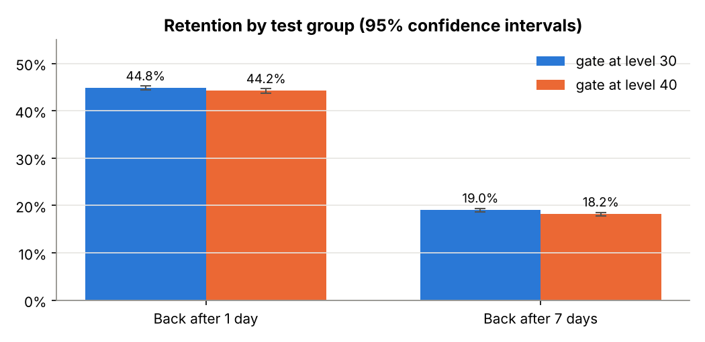 | 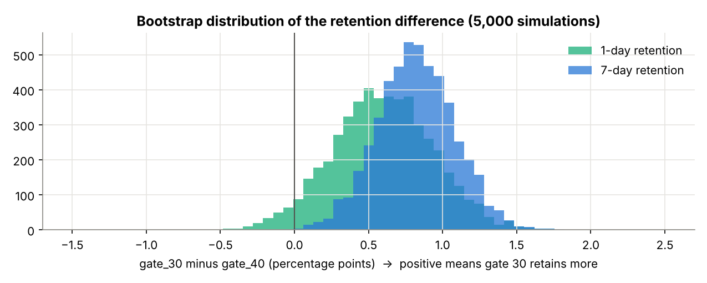 |

**Recommendation:** keep the gate at level 30 and audit the assignment pipeline. → [Notebook](05-mobile-game-ab-test/analysis.ipynb)

### 03 · E-commerce late deliveries: the cost in reviews

> How often do marketplace orders miss the promised date, how much does it hurt reviews, and where and when does it happen?

- **6.8%** of delivered orders arrived late, although the median order arrived **12 days early**.
- Average review: **4.29** stars on time against **2.27** late; 8+ days late averages **1.70**. Late orders cause **36.7%** of all one-star reviews.
- The late rate hit **12.4%** in Black Friday month and **19.0%** in March 2018. Maranhão is late 17.4% of the time; São Paulo 4.5%.

| Review score by lateness | Late rate by month |
|---|---|
| 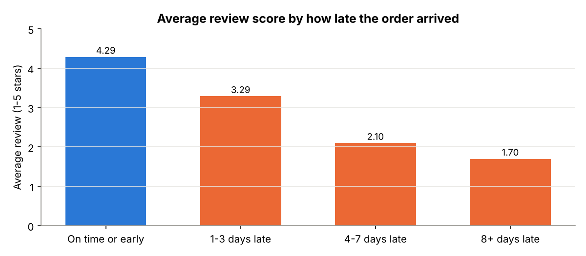 | 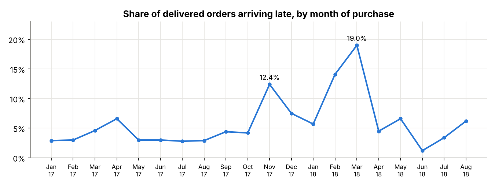 |

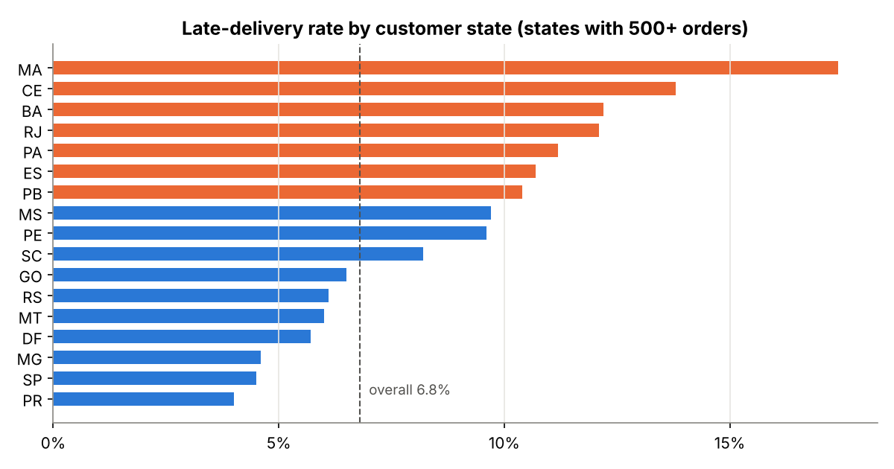

**Recommendation:** set promised dates by state and season, add courier capacity before peaks, and warn customers proactively. → [Notebook](06-ecommerce-late-deliveries/analysis.ipynb) · [SQL](06-ecommerce-late-deliveries/queries.sql)

### 04 · UK online retailer: where the revenue comes from

> How seasonal is the business, and which customers keep coming back?

- **£9.63m** revenue from 18,957 orders; September to November brought in **37.2%** of the year.
- No Saturday trading at all; the busiest window is 10:00 to 16:00, Tuesday to Thursday.
- Champions are **14.1%** of customers and **45.3%** of revenue; **602** at-risk customers worth **£625k** are a win-back target.

| Monthly revenue | RFM segments |
|---|---|
| 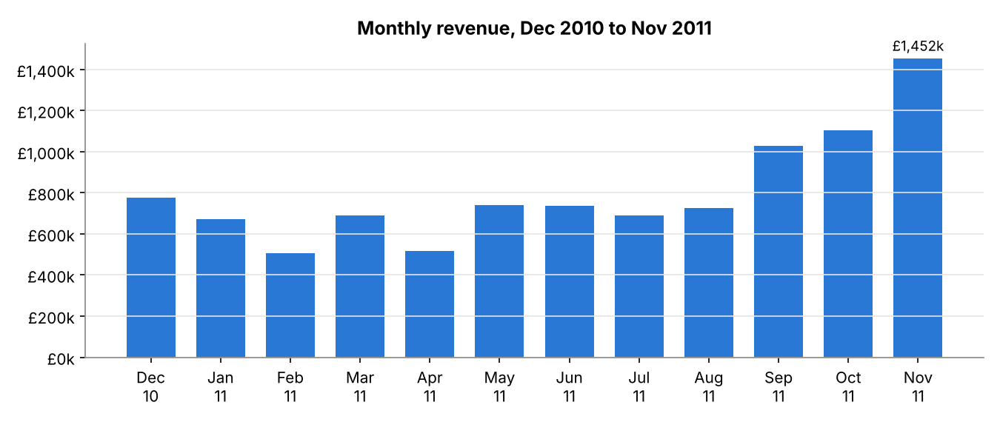 | 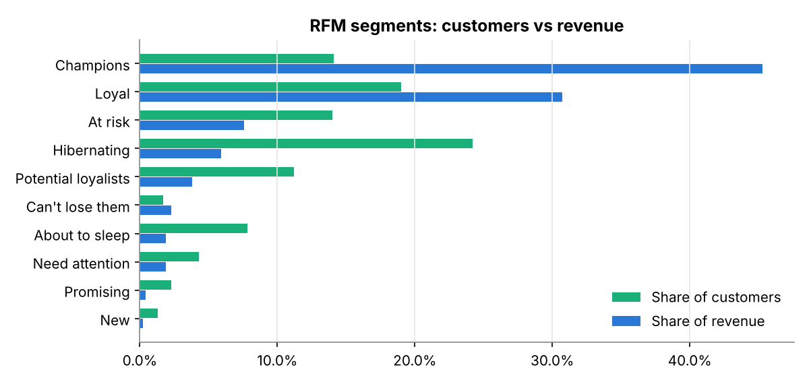 |

| Cohort retention | Revenue by day and hour |
|---|---|
| 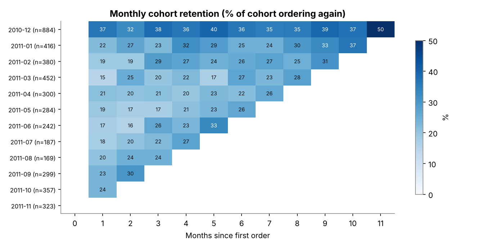 | 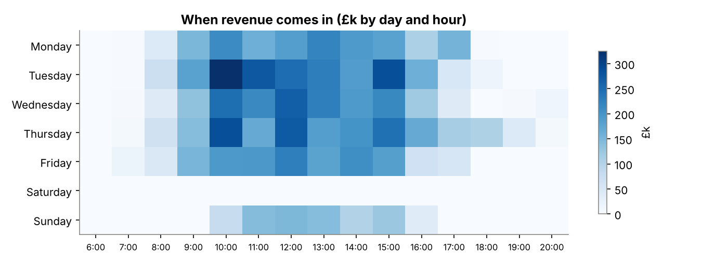 |

→ [Notebook](01-uk-online-retail/analysis.ipynb) · [SQL](01-uk-online-retail/queries.sql)

### 05 · Network intrusion data: what accuracy hides

> Which features reveal an attack, and how well does a model catch attacks it has never seen?

- **16.6%** of test traffic is attack types that never appear in training.
- A random forest scores **99.88%** in cross-validation but **76.5%** on the official test set.
- It catches **76.8%** of known attack types but only **22.0%** of new ones.

| Detection rate by attack type | Training vs test traffic mix |
|---|---|
| 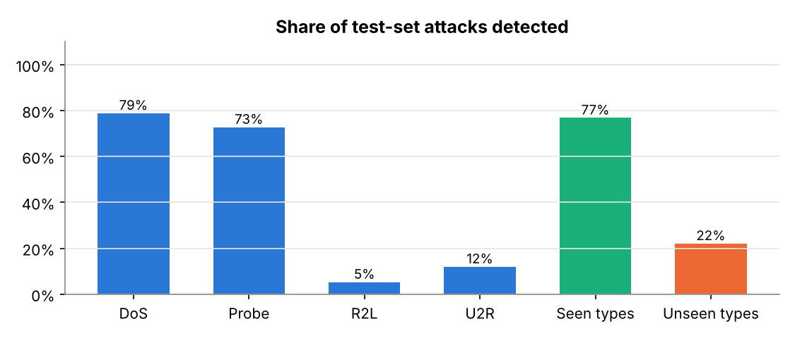 | 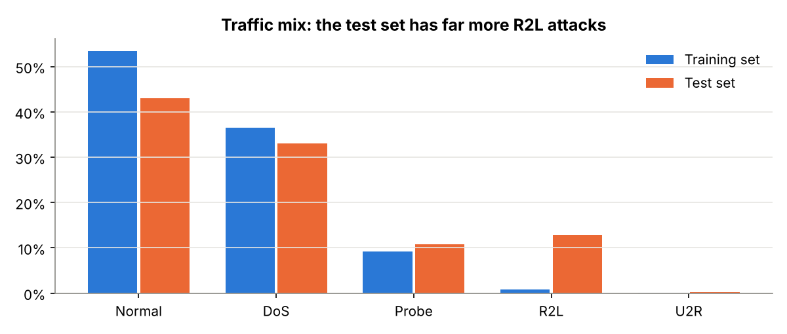 |

→ [Notebook](03-network-traffic-eda/analysis.ipynb)

### 06 · UK house prices since 1953: crashes and recoveries

> How deep were past downturns, and how long did prices take to get back to their peak?

- Validated the data first: every published annual change matches a recalculation to within 0.1 points.
- Three downturns of more than 5%: **−20.2%** (1989–93, 8.5 years to recover), **−18.7%** (2007–09, 6.8 years), **−5.5%** (2022–23, not yet recovered by mid-2025).

| Long-run price (log scale) | Annual change |
|---|---|
| 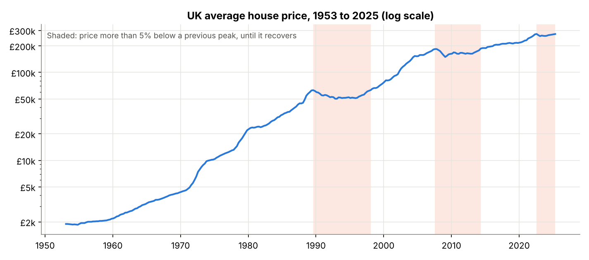 | 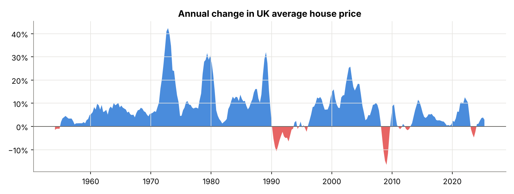 |

→ [Notebook](02-uk-house-prices/analysis.ipynb)

## The website

The portfolio site lives in [`docs/`](docs) and is served by GitHub Pages. It's plain HTML, CSS and JavaScript with no build step.

**Six case studies, filterable by skill.** Each card leads to a full write-up with interactive charts (hover any bar or line for the numbers).

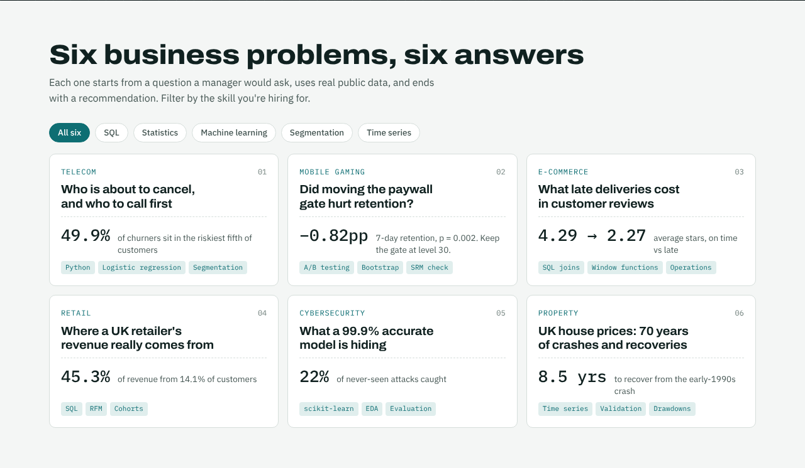

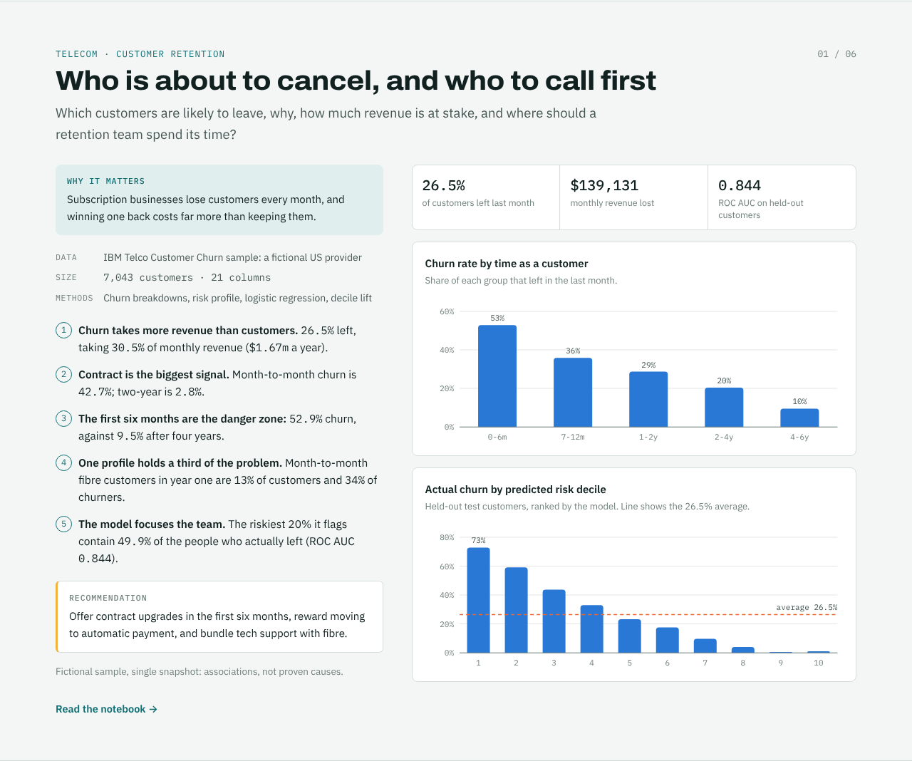

**A contact form written as an SQL query.** Visitors fill in the blanks of an `INSERT INTO inbox` statement and press *Run query*. A Google Apps Script saves each message to a Google Sheet and emails me straight away ([setup guide](contact-backend/SETUP.md)).

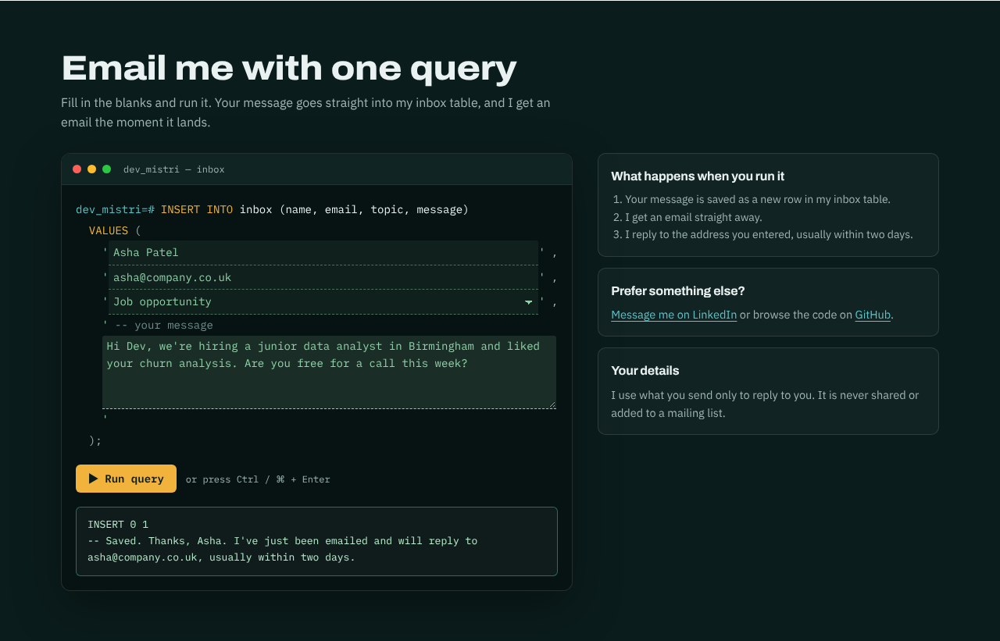

**An online resume** with a back button, tap-to-call phone, email and profile links, and a *Save as PDF* button that prints a two-page A4 resume.


**Works on phones and in dark mode.**

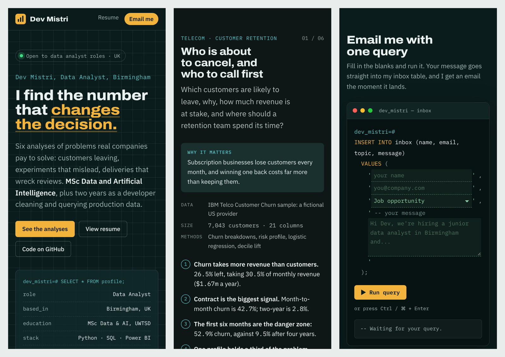

## Repository layout

```
01-…06-*/              one folder per analysis: analysis.ipynb, README.md, images/, results/summary.json
docs/                  the website (index.html, resume.html, assets/, data/site-data.js)
contact-backend/       Google Apps Script for the contact form, plus SETUP.md
scripts/               build_site_data.py copies each analysis's results into the website
screenshots/           the images used in this README
```

## Run it yourself

```bash
git clone https://github.com/D3vxc/data-analysis-portfolio
cd data-analysis-portfolio
pip install -r requirements.txt
jupyter notebook          # each notebook downloads its own data on first run
```

After re-running a notebook, refresh the website's numbers with `python scripts/build_site_data.py`. To preview the site, open `docs/index.html` in a browser.

## Data sources

IBM Telco Customer Churn sample · Cookie Cats A/B test (Tactile Entertainment, via DataCamp) · Olist Brazilian e-commerce public dataset (CC BY-NC-SA 4.0) · UCI Online Retail (Chen, Sain & Guo, 2012) · NSL-KDD (Canadian Institute for Cybersecurity) · Nationwide House Price Index (via datasets/house-prices-uk, ODC-PDDL).
